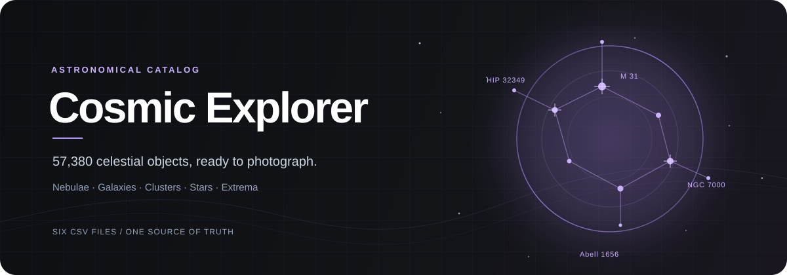

<div align="center">
  
</div>

<p align="center">
  <a href="https://cosmic-atlas.app/"></a>
  <a href="https://play.google.com/store/apps/details?id=com.cosmic.atlas"></a>
  <a href="https://discord.com/invite/JvPSgHA2jB"></a>
</p>

<p align="center">
  
  
  
</p>

# Cosmic Explorer Catalog

**The data layer behind [Cosmic Atlas](https://cosmic-atlas.app/)** — 57,380 celestial objects in six CSV files,
built for astrophotography planning.

## What is Cosmic Atlas?

[Cosmic Atlas](https://cosmic-atlas.app/) is a mobile planner for astrophotography. It combines weather, Moon phase,
catalog visibility and equipment profiles to answer one question: *what can I photograph tonight, and when?*

The app is available on **[Google Play](https://play.google.com/store/apps/details?id=com.cosmic.atlas)**.

This repository is the **catalog** half of that experience: the objects themselves, their coordinates,
magnitudes, sizes and cross-references — maintained here once and handed to every application as a copy.

## What is inside

| Dataset | Objects | Content |
|---|---:|---|
| Nebulae | 2,646 | emission, reflection, planetary, dark nebulae, supernova remnants |
| Galaxies | 9,918 | every morphological type |
| Star clusters | 3,181 | open and globular |
| Galaxy clusters | 53 | groups and clusters |
| Stars | 41,529 | down to magnitude 8 |
| Extrema | 53 | black holes, quasars, pulsars, deep fields |
| **Total** | **57,380** | |

Every object carries its catalog designations - **53 families** in total: Messier, NGC, IC, Caldwell,
Sharpless, Barnard, LDN, LBN, Collinder, Melotte, Abell, Arp, PGC, UGC, UGCA, MCG, ESO, MWSC, HIP, HD,
HR, SAO, Gliese, HCG, FSR, Berkeley, Trumpler, Czernik, Dolidze, Ruprecht, Teutsch,
Stock, Pismis, King, Terzan, Lynga, Bochum, Basel, Hogg, Koposov, Loden, Alessi, Haffner, Kronberger,
ASCC, IRAS and more. The full index is in `catalog/by-designation/`.

Each row also carries position (RA/Dec), constellation, magnitude, angular size, surface brightness,
position angle, distance, spectral type for stars, opacity for dark nebulae and an astrophotography
suitability score. Two cross-reference columns point at another object without becoming aliases:
`Related_Star` (the star that lights a nebula) and `Neighbor_Star` (a bright star next to a galaxy or cluster).

## Where this is going

How full the catalog is today, and the realistic target for every column. A target is bounded by
physics and by the sources: dark nebulae have no magnitude, MWSC publishes none for clusters.

| Dataset | Column | Now | Target | Needs |
|---|---|---:|---:|---|
| Nebulae | Magnitude | 13% | **25%** | 1,976 of 2,646 are dark nebulae — they have no magnitude |
| Nebulae | Angular size | 100% | 100% | done |
| Nebulae | Position angle | 7% | **40%** | NED |
| Nebulae | Distance | 2% | **60%** | NED |
| Galaxies | Magnitude | 98% | **100%** | NED |
| Galaxies | Surface brightness | 96% | **100%** | NED |
| Galaxies | Position angle | 96% | **100%** | NED |
| Galaxies | Distance | 28% | **90%** | NED / RC3 |
| Star clusters | Magnitude | 24% | **60%** | Dias |
| Star clusters | Position angle | 4% | **30%** | — |
| Star clusters | Distance | 87% | **95%** | MWSC, already matched |
| Galaxy clusters | Position angle | 53% | **70%** | — |
| Galaxy clusters | Abell designation | 8 of 12 clusters | **complete** | the other 4 are regions, not Abell clusters; the 41 groups carry HCG numbers instead |
| Extrema | Magnitude | 83% | **90%** | — |
| Extrema | Distance | 21% | **40%** | redshift only, where published |
| Extrema | Size, surface brightness | 0% | **0%** | point sources: these fields cannot exist |
| Stars | Magnitude, distance, type | 100% | 100% | done |

Position and constellation are complete (100%) in all six catalogs.

### Next sources

| Source | What it unlocks | Status |
|---|---|---|
| **NED / RC3** | nebula distances, galaxy surface brightness and position angles | unreachable from the working network |
| **Dias** | magnitudes for MWSC clusters | not downloaded |
| **Gaia DR3 / Tycho-2 / 2MASS** | extra star designations | optional, large downloads |

## Who reads it

| Consumer | Format |
|---|---|
| Cosmic Atlas mobile app | JSON, split into chunks of 500 objects |
| Cosmic Atlas website | the CSV files, served directly |
| Cosmic Atlas v1 (legacy) | the CSV files, served directly |

## Quick start

```bash
python scripts/find_object.py            # look up an object by name
python scripts/convert_catalog.py        # export CSV or JSON into exports/
python scripts/verify_all.py             # run every check
```

## Documentation

| Document | Content |
|---|---|
| **[docs/catalog.md](docs/catalog.md)** | everything about the data: columns, conventions, order, ID vs UID, duplicates, sources |
| **[docs/history.md](docs/history.md)** | v1 vs v2: objects, identifiers, every column, what was removed |
| **[docs/scripts.md](docs/scripts.md)** | the update pipeline and every tool |

## Versions

- **v2** — tag `v2`, which is `main`: the current catalog, sorted by area.
- **v1** — tag `v1`: the original data, 24,924 objects, six CSVs and translations only.

## Rules that never change

1. **The CSV is the source of truth**; applications receive generated copies.
2. **`UID` is saved, `ID` is displayed.** A UID never changes, never moves and is never reused.
3. Canonical order: area descending, stars by magnitude, `extrema` untouched.
4. `0` means unknown, `-` means absent.

## License

Data is distributed under **CC BY-SA 4.0** (`LICENSE`), because it is derived from HYG and OpenNGC.
Attribution and modifications: `catalog/ATTRIBUTION.md`.
